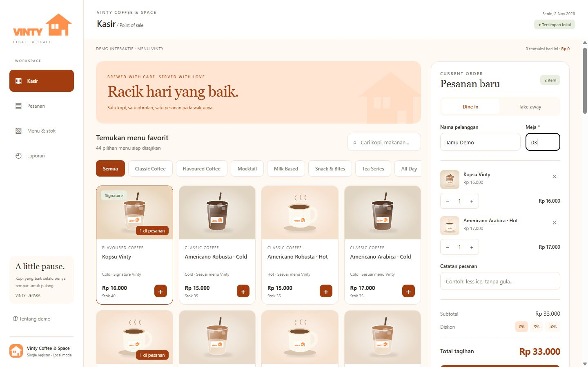

# Vinty POS

[](https://github.com/arhaqx/veloce-landing-page/actions/workflows/ci.yml)

A functional single-register POS prototype for **Vinty Coffee & Space** in Jepara. Project date: **15 February 2026**. Expo + React Native + TypeScript power both the mobile app and the interactive web demo embedded in the portfolio.

The catalog follows the supplied Vinty menu: 34 menu items represented by 44 serving variants, with original prices in rupiah. The orange VINTY wordmark and house mark follow the supplied identity. Stock and transactions are simulated; product images are illustrations. The app is not presented as an operational production deployment.

[Open the app](https://veloce-landing-page.vercel.app) · [Portfolio case study](https://arhaq.dev/projects/vinty-coffee-and-space) · [Embedded demo](https://arhaq.dev/projects/vinty-coffee-and-space/demo)



This repository is the canonical application source. It builds and deploys independently of the [portfolio](https://github.com/arhaqx/portfolio). The existing `veloce-landing-page` repository URL is retained; the previous Veloce landing page is preserved on the [legacy/veloce-landing-page branch](https://github.com/arhaqx/veloce-landing-page/tree/legacy/veloce-landing-page) and in Git history.

## Run the app

Use Node.js 22 LTS and npm (`.nvmrc` is included; minimum Node.js 20.19.4). This application uses the Expo SDK 54 dependency set with its own lockfile.

From a fresh checkout:

```sh
git clone https://github.com/arhaqx/veloce-landing-page.git
cd veloce-landing-page
npm ci
npm start
```

In Expo CLI, open an Android emulator, a compatible development build, or a compatible Expo Go client. The currently installed Expo Go must support SDK 54; otherwise use a development build or the matching Android Expo Go version from Expo's official downloads. To run the browser during development:

```sh
npm run web
```

For a production web export and local preview:

```sh
npm run build:web
npm run preview
```

Open `http://127.0.0.1:4173/demos/vinty-pos/index.html`. Generated files live in the ignored `dist/web/` directory. Set `PORT` to use another preview port.

| Command | Purpose |
| --- | --- |
| `npm start` | Start Expo development server |
| `npm run android` / `npm run ios` | Open the native development target |
| `npm run web` | Start Expo web development |
| `npm run typecheck` | Check TypeScript |
| `npm test` | Run domain regression tests |
| `npm run build:web` | Export production web files and build provenance |
| `npm run preview` | Serve the production export locally |
| `npm run export:android` | Export the Android JavaScript/Hermes bundle |
| `npm run assets:generate` | Regenerate illustrative menu assets from the source vectors |

## Try the workflow

1. In **Kasir**, search/filter the menu and add items. Open **Buka pesanan** on small screens.
2. Choose dine in and enter a table, or choose take away. Customer and notes are optional.
3. Apply 0%, 5%, or 10% discount. In **Laporan**, optional tax/service rates can be set from 0–30%.
4. Pay using cash (with tender validation and change) or explicitly confirm a manual QRIS recording. This demo does not transfer money.
5. Save/share the receipt or open the system print dialog. In **Pesanan**, advance fulfillment from new → making → ready → completed.
6. Cancel a paid transaction with a reason to restore its stock once. Cash refunds must be handled separately; cancellation changes the local record only.
7. In **Menu & stok**, add/edit menu items, change prices, replenish portions, or deactivate products. Items reserved in the cart cannot be deactivated or reduced below the reserved quantity.
8. View **Laporan** for revenue, order counts, average order value, bestseller quantities, and payment breakdown. Export the selected period to CSV, including cancelled transactions marked `voided`.

## Data and calculation rules

- All money uses integer rupiah; percentage rates use integer basis points.
- Discount is rounded from the subtotal; service and tax are separately rounded from the discounted subtotal. Tax excludes service. Both fees default to zero; this demo rule is configurable data, not a statement about the café's actual tax policy.
- Inventory tracks servings/portions per menu variant, not ingredient recipes or COGS.
- Checkout creates immutable item/name/price snapshots and updates stock/cart/orders in one AsyncStorage value. The UI acknowledges payment only after a successful storage write.
- Catalog revision 2 upgrades the original sample catalog while preserving stored orders, custom menu items, stock quantities, and historical prices. An existing unpaid cart keeps its original prices until completed or emptied; the official menu is then applied. Retired sample products remain inactive for historical stock reversals.
- Storage key: `vinty-pos:v1`, with a validated schema and optimistic revision check. Web Locks serialize writes across supported browser tabs. Use one active register session; older browsers without Web Locks do not have a full concurrent-write guarantee.
- Orders and cart survive normal reloads. Unsaved customer/table/note fields and pending payment forms are transient. App data is device/browser-local and can be lost if the user clears site/app storage. CSV export is a transaction report, not a restorable complete backup.
- Business dates and daily receipt sequences use `Asia/Jakarta`. Daily reports count paid, nonvoided orders and include configured tax/service in revenue.
- Corrupt/incompatible saved state is rejected without automatically deleting/reseeding existing data.
- A loaded app can keep recording locally without network. The exported website needs a connection for its initial load and is not a service-worker-cached PWA. Mobile binaries package the JS/assets locally.

## Verification

```sh
npm run typecheck
npm test
npm run build:web
npm run export:android -- --max-workers 2
```

GitHub Actions runs these checks for pushes to `main` and pull requests, and uploads the web and Android bundles as seven-day artifacts. The domain tests cover calculation rounding, payment/stock validation, QRIS confirmation, price snapshots, void reversals, receipt sequences, WIB boundaries, report aggregation, formula-safe CSV, and restart/schema validation. Browser QA covers checkout, persistence after reload, order handling, inventory, reports, exports, and responsive layouts.

## Independent web deployment

`vercel.json` installs this repository's dependencies and exports `dist/web`. `/` redirects to `/demos/vinty-pos/index.html`; prefixed asset requests map to the export. Expo's `experiments.baseUrl` preserves the same path for direct and embedded use.

The portfolio contains the case study and screenshots, and proxies `/demos/vinty-pos/:path*` to this deployment through a Next.js external rewrite. It does not contain or build the Expo source. Keeping the portfolio demo URL also keeps existing browser-local transactions on the same origin.

`/demos/vinty-pos/build-info.json` identifies the source repository, Git commit, version, and build time for deployment verification. No credentials or environment variables are included.

## Android release

`export:android` verifies the Android JavaScript/Hermes bundle; it does **not** produce an installable APK or validate device-specific behavior. An APK can be produced with an authenticated Expo EAS account:

```sh
npx eas-cli build --platform android --profile preview
```

EAS project registration, credentials, any build quota/cost, physical-device testing, and store submission are separate release steps. `eas.json` includes an internal-preview APK profile. No APK or app-store release is claimed by this repository.

## Source selection and attribution

Research and implementation notes are in [docs/IMPLEMENTATION.md](docs/IMPLEMENTATION.md). The selected open-source reference is **[RetailPOS](https://github.com/n17foo/retailpos)** (Expo/React Native, Apache 2.0). Only its money utilities were adapted into this implementation; the complete upstream stack was not forked. See [THIRD_PARTY_NOTICES.md](THIRD_PARTY_NOTICES.md) for the pinned source revision, changes, and preserved license.

## Structure

```text
App.tsx             Navigation, loading, persisted mutations, receipt display
src/Register.tsx    Catalog, cart, discounts, checkout
src/Management.tsx  Orders, menu/stock, reports, fee settings
src/model.ts        Pure domain rules, schema validation, report/CSV logic
src/money.ts        Adapted integer-rupiah helpers
src/store.ts        AsyncStorage and revision/write lock
src/receipts.ts     Receipt text, system print/share, CSV export
src/ui.tsx          Accessible shared controls and modals
src/theme.ts        Vinty visual tokens
assets/             Vinty identity and illustrative menu artwork
tests/pos.test.ts   Domain regression tests
scripts/            Portable web export, preview and asset generation
docs/               Implementation notes and actual app screenshots
.github/workflows/  Continuous verification
vercel.json         Independent static web deployment
```

No staff authentication, backend sync, server backup, real QRIS verification, printer Bluetooth integration, or production operational rollout is included in this version.
